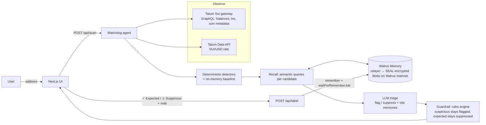

# 🐕 Sui Wallet Watchdog

**An AI agent that watches a Sui wallet, flags unusual activity, and *remembers your answers* on Walrus Memory, so it stops raising the same false alarms.**

Built for **Total Recall · Tatum × Walrus Memory Hackathon** (track: *Smart Agents for Real Life*).

- **Tatum** supplies the onchain data: Sui mainnet balances and transactions through Tatum's Sui gateway, plus the SUI/USD price from the Tatum Data API.
- **Walrus Memory** stores what the agent learns: every "expected" or "suspicious" label and every standing preference is written as an encrypted memory on Walrus mainnet and recalled by semantic search on the next scan.
- **An LLM** (any OpenAI-compatible API) triages detector hits *with those memories in context* and cites the memories it used.

Most wallet monitors cry wolf. You learn to ignore them, and then you miss the alert that matters. Watchdog gets quieter about the things you have approved and stricter about the things you said were suspicious.

---

## How it works



### The learning loop

1. **Observe:** fetch balances, the latest ~25 transactions (sent or received) and the SUI price through Tatum.
2. **Detect:** deterministic detectors produce *candidates*: large outflows (absolute or relative to the wallet's own median), first-time counterparties, unsolicited unknown tokens (airdrop phishing), calls to never-seen packages, failed transactions, high gas and bursts of outgoing transactions. With no memory, this list is what a naive watchdog would show.
3. **Recall:** one broad query plus one query per distinct candidate subject (`"large outflow involving 0xe5…"`) go to Walrus Memory (`recall({ query, namespace, limit })`). Results are de-duplicated by blob id and filtered to this wallet.
4. **Decide:** the LLM gets the candidates and the numbered memories (`M1…Mn`). For each candidate it returns `flag` or `suppress`, a severity, a reason and the memory ids it relied on. The output is validated with zod. A deterministic rules engine handles a missing or failing LLM and acts as a guardrail: once you have marked a pattern **suspicious**, the model can never suppress it.
5. **Learn:** you click **✓ Expected** or **⚠ Suspicious** (plus an optional note). The label becomes a memory, gets stored with `remember()` and `waitForRememberJob()`, and the UI shows the Walrus blob id.
6. **Re-scan:** the **Before / after memory** panel shows every baseline alert next to the agent's decision, marks items it has newly learned to suppress, and shows "Learned from N memories".

### Memory format

Each memory has a natural-language sentence (good for embeddings and semantic recall) and a machine-readable tag line (good for deterministic rules and provenance):

```
User marked "large outflow" involving 0xe5e5…e5e5 on wallet 0xd3d3…d3d3 as EXPECTED. Note: This is my own cold wallet. Weekly savings transfers here are expected.
[watchdog:v1] {"type":"label","address":"0xd3…","verdict":"expected","kind":"large_outflow","subject":"0xe5…","note":"This is my own cold wallet. Weekly savings transfers here are expected.","createdAt":"…"}
```

Memories are scoped to one Walrus Memory **namespace per wallet** (`sui-watchdog-<first 16 hex of address>`). Notes are sanitised (single line, max 280 chars, the tag can't be spoofed), and the prompt tells the model to treat memory and transaction text as data, not instructions.

### Project layout

```
src/lib/sui/graphql.ts      Tatum Sui gateway client (GraphQL; throttled, 429 retry, pruned-checkpoint handling)
src/lib/sui/snapshot.ts     balances + txs + coin metadata + Tatum price → WalletSnapshot
src/lib/price/tatum.ts      Tatum Data API: GET /v4/data/rate/symbol
src/lib/agent/detect.ts     deterministic detectors (no-memory baseline)
src/lib/agent/scan.ts       observe → detect → recall → decide orchestration
src/lib/agent/rules.ts      memory rules engine (fallback + guardrail)
src/lib/agent/prompt.ts     system prompt, user prompt, zod output schema
src/lib/agent/learn.ts      labels/preferences → Walrus Memory writes
src/lib/memory/store.ts     MemWal (mainnet) / MemWalMock (offline) behind one interface
src/lib/memory/format.ts    memory text format, parsing, sanitising, namespaces
src/lib/llm/provider.ts     provider-agnostic OpenAI-compatible client
src/app/api/*               scan, label, preference, memories, status route handlers
scripts/seed-memories.ts    writes the starter security profile (≥10 memories)
scripts/check-integrations.ts  live smoke test of Tatum, Walrus Memory and the LLM
```

## Setup

Requirements: Node 22+.

```bash
npm install
cp .env.example .env.local   # then fill in the keys below
npm run check -- 0xYOUR_ADDRESS   # live smoke test of every integration
npm run seed  -- 0xYOUR_ADDRESS   # writes the starter profile to Walrus mainnet (≥10 memories)
npm run dev                        # http://localhost:3000
```

| Variable | Required | What it is |
|---|---|---|
| `TATUM_API_KEY` | yes (prod) | Tatum API key ([dashboard](https://dashboard.tatum.io)). Used for `https://sui-mainnet.gateway.tatum.io/graphql` and `https://api.tatum.io/v4/data/rate/symbol`. |
| `MEMWAL_KEY` | yes (prod) | Walrus Memory delegate **private** key ([dashboard](https://memory.walrus.xyz/dashboard) → Delegate keys). |
| `MEMWAL_ACCOUNT_ID` | yes (prod) | Walrus Memory account object id. |
| `OPENAI_API_KEY` | recommended | Any OpenAI-compatible key. Without it the agent runs in rules-only mode. |
| `OPENAI_BASE_URL`, `LLM_MODEL` | optional | e.g. `https://api.x.ai/v1`, `https://openrouter.ai/api/v1`; default model `gpt-4o-mini`. |
| `MEMWAL_SERVER_URL` | optional | default `https://relayer.memory.walrus.xyz` |
| `WATCH_ADDRESS` | optional | Default address for server scripts (`npm run seed`, `npm run check`) only. Never sent to the client or pre-filled in the UI. |
| `RATE_LIMIT_PER_HOUR` | optional | Per-IP scan limit (default 20; `0` disables). |
| `SESSION_SECRET` | yes (prod) | HMAC key for Sign-in-with-Sui session cookies and nonces. |
| `AUTH_DOMAIN` | optional | Domain bound into the sign-in message (defaults to the request Host). |

Each integration has an offline fallback, so you can clone the repo, run `npm install && npm test && npm run build`, and it works with **no keys**: public Sui GraphQL for dev, the SDK's `MemWalMock` for memory, and rules-only triage.


## Security: Sign in with Sui

Anyone can **scan** a wallet — on-chain activity is public. Teaching the agent is not:

- **Sign in** with a wallet-standard wallet on Sui mainnet (Slush and others via `@mysten/dapp-kit-react`). The server issues a short-lived HMAC-signed nonce; you sign a personal message (no gas) covering the domain, address, nonce, issued-at and expiry. A successful verify sets an httpOnly, Secure, SameSite=Lax session cookie (~12 hours) bound to that address.
- **Every label and preference write** needs a *fresh* wallet signature over a human-readable approval (kind, subject, tx digest, verdict, note, nonce, expiry). The server checks that the signature address, the session, and the request body all match, and that the signed text is exactly the message rebuilt from the body.
- **Memory reads** (`/api/memories`) require a session for that address.
- **Unauthenticated scans** of someone else's wallet still apply stored labels (so suppression works) but **redact note text and the memory list**. Counts and flag/suppress decisions remain. See `docs/SECURITY.md`.
Nonces are stateless (HMAC + expiry, 5 minutes) so they work across serverless instances. There is no shared replay cache: a captured unused nonce could be replayed until it expires. Login replay only mints another session for the same address; an action replay could duplicate a memory. That's the tradeoff versus running Redis. Signatures still have to come from the wallet owner.

### Deploy to Netlify (or Vercel)

The live demo is on Netlify (`netlify.toml`, Node 22). Import the repo or run `netlify deploy --build --prod`, add the env vars above (including `SESSION_SECRET` as a secret), and deploy. Same env vars work on Vercel. The API routes set `maxDuration` to 60 s because Walrus writes wait for the upload job to finish.

## Demo

1. Open the app. The address box starts empty. Connect a Sui wallet and **Sign in with Sui**, or paste a mainnet address. (`npm run seed -- 0xYOUR_ADDRESS` writes a starter security profile to that wallet's namespace.)
2. **Scan.** Tatum reads balances and recent transactions. Deterministic detectors raise a no-memory baseline; Walrus Memory is recalled and applied so previously approved patterns can be suppressed.
3. Teach it live: mark an alert **✓ Expected** or **⚠ Suspicious** (plus an optional note). Your wallet signs a personal message — no gas. Each card shows the Walrus blob id.
4. **Re-scan.** Newly approved patterns move to *Suppressed by memory* with a 🧠 citation; patterns you mark suspicious stay flagged (and are escalated to **high**). A guardrail prevents the model from reversing those labels.
5. Standing preferences (a threshold or a note) can be added in the memory panel; those writes also require a fresh wallet approval.

The learning loop is also covered in unit tests with a scripted fixture wallet: six baseline alerts, three suppressed after the starter profile plus labelled approvals are recalled.

## Scripts

| | |
|---|---|
| `npm run dev` / `build` / `start` | Next.js |
| `npm test` | Vitest: detectors, memory format, rules, full learn loop on `MemWalMock`, LLM merge and guardrail, Tatum client retry, provider fallback |
| `npm run typecheck` | `tsc --noEmit` |
| `npm run seed -- <address> [--dry-run]` | starter profile to Walrus Memory (≥10 memories) |
| `npm run check -- <address>` | live integration smoke test |

## Notes and limitations

- Sui has deprecated JSON-RPC. Tatum's Sui mainnet gateway serves **GraphQL** (`/_methods` on the gateway lists `sui-mainnet-graphql`), so that is what the app uses. Tatum prunes old history and reports its lowest retained checkpoint; the client reads that and bounds queries to it.
- Detection covers the most recent 10 transactions and uses the latest ~25 as history. It is a triage assistant, not a guarantee.
- Memories are encrypted by the Walrus Memory relayer (SEAL) before upload. Anyone with the delegate key can read and write the namespace, so keep `MEMWAL_KEY` server-side only.

MIT licensed.
